# Kido Clock

By **Mateusz Misztoft** · follow the project and get in touch on X: [@mat_misztoft](https://x.com/mat_misztoft)

**Version 1.3.2** — a sleep-training clock for kids, built on an ESP32-C3 and a round 1.28" colour screen.

Small children can't read the time yet, so Kido Clock shows a picture instead:

| Picture | Meaning |
|---|---|
| sleepy moon | still too early, stay in bed |
| sun | you can get up |
| book | story time |
| bed | bedtime |

Parents set the times, days, icons, colours and brightness from a phone at **http://kido-clock.local**.
No app, no cloud and no account are needed. The time comes from NTP over your home Wi-Fi.

## Why I built this

My son (almost 3 y.o.) wakes up between 6 and 7 every morning and runs to my bed asking, "Is it day yet?" What he really means is, are we getting up already?

So I decided to build him a clock that shows him what he can do right now. I kept the controls simple, just one button, so he can check on his own what time of day it is. He walks up, presses it, and knows if it's time for lunch, getting dressed for preschool, brushing his teeth, or taking a bath before bed.

I also added a time display, so as he gets older, we can slowly learn how to read both analog and digital clocks.

And for me, there's a simple web panel where I can set up the schedule for each day of the week, with specific times for each activity.

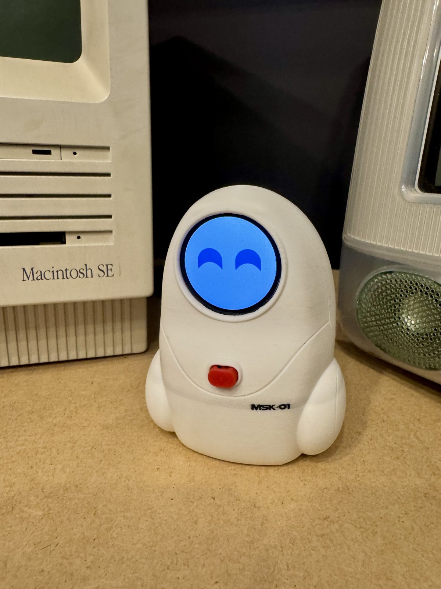

*The finished MSK-01 test build.*

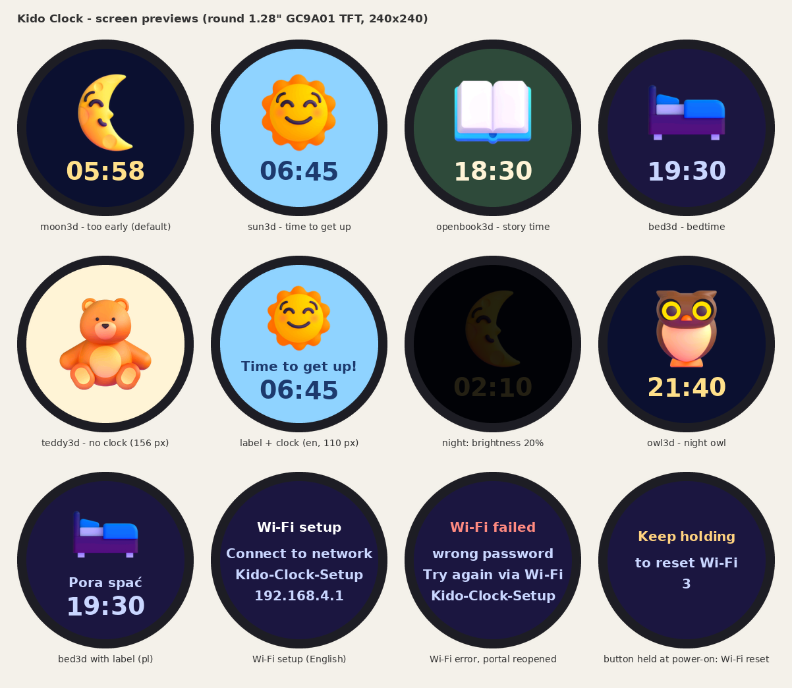

## Settings panel

Screenshots from a phone (mobile layout):

| Overview | Edit a time slot | Icon picker |
|---|---|---|
| 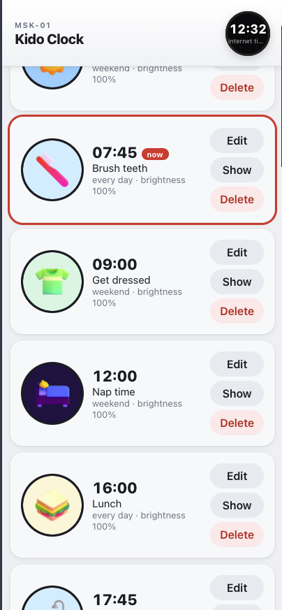 | 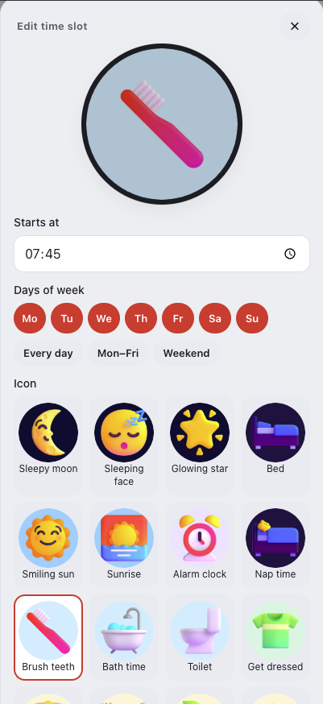 | 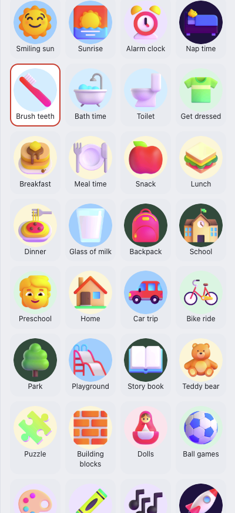 |

| Screen brightness and clock style | Screensaver |
|---|---|
| 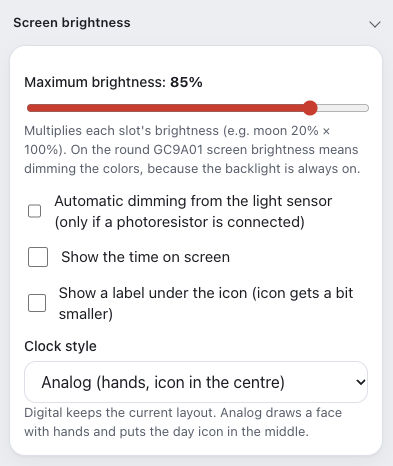 | 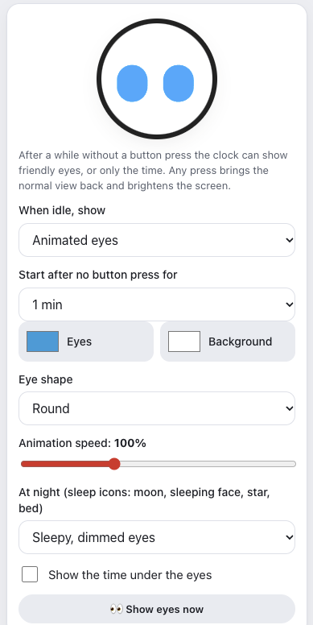 |

## Features

- Time slots with any start time and any days of the week (weekday and weekend plans), each with an icon, colours, an optional label and a brightness level.
- 58 colour 3D icons ([Fluent Emoji](https://github.com/microsoft/fluentui-emoji) by Microsoft, MIT), built into the firmware. See [Icons](#icons).
- Optional clock and label under the icon. Clock style is **digital** or **analog** (analog draws a face with the slot icon in the centre).
- Screensaver modes: **off**, **eyes**, or **clock** (large idle clock in the slot colours).
- Animated eyes screensaver, drawn in code: the eyes look around, blink, squint happily, look surprised, wink and get sleepy. See [Eyes screensaver](#eyes-screensaver).
- Wi-Fi badge on the screen while reconnecting, and automatic reconnect after a router restart (mDNS is re-announced on `GOT_IP`).
- Colour controls for cheap panels that look washed out: a **panel colour profile** (GC9A01 gamma: Standard, Vivid, Extra vivid) and a **Vivid colours** slider for the icons and eyes. See [Colours](#colours).
- Optional automatic dimming with a light sensor, and an optional button.
- 5 languages on the screen and in the web UI: English (default), Polish, German, Spanish and French. The language is chosen on the first page of the Wi-Fi setup portal. [Adding a language](#adding-a-language) is one JSON file.
- Settings survive power loss (JSON on LittleFS). Wi-Fi setup uses a captive portal, with clear error messages when the connection fails.
- Single 3 MB app partition (no OTA), so there is room for the colour icons.
- Product settings UI (MSK-01): clean phone page at `http://kido-clock.local`.

## Bill of materials

| Part | Qty | Approx. price |
|---|---|---|
| ESP32-C3 SuperMini (4 MB flash, USB-C) | 1 | ~2-3 USD / ~22 PLN |
| Round 1.28" IPS TFT 240x240, **GC9A01**, 7 pins (RST CS DC SDA SCL GND VCC) | 1 | ~1-1.5 USD / ~28 PLN |
| Female-female jumper wires, 10 cm | 7-10 | - |
| USB-C cable + any 5 V phone charger | 1 | - |
| *Optional:* GL5528 photoresistor + 10 kΩ resistor | 1 + 1 | cents |
| *Optional:* 6x6 mm tact switch | 1 | cents |
| *Optional:* 3D-printed enclosure (~40 g PLA) | 1 | - |

Full list with links and prices (PLN and USD), landed cost and a retail-price calculator: [`bom/bom_v2.xlsx`](bom/bom_v2.xlsx) (also `.csv`).
A variant with a 2.0" ST7789 240x320 screen is in `bom/bom_v1.*`.
Parts cost about **8-18 USD** per unit, depending on where you buy. Prices are a snapshot from October 2026.

## Wiring

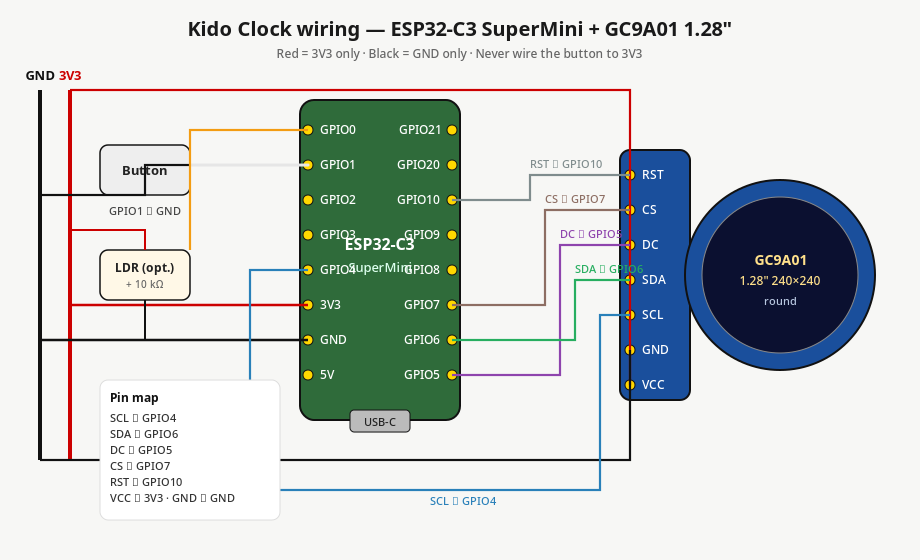

Vector source: [`docs/images/wiring.svg`](docs/images/wiring.svg) (also [`docs/wiring.svg`](docs/wiring.svg)).

| Display pin | Function | ESP32-C3 SuperMini |
|---|---|---|
| VCC | power | **3V3** (not 5V) |
| GND | ground | **GND** |
| SCL | SPI clock (SCK) | **GPIO4** |
| SDA | SPI data (MOSI) | **GPIO6** |
| DC | data/command | **GPIO5** |
| CS | chip select, *optional* | **GPIO7** |
| RST | reset, *optional* | **GPIO10** |

| Optional part | ESP32-C3 SuperMini |
|---|---|
| Light sensor: 3V3 → photoresistor → **GPIO0** → 10 kΩ → GND | GPIO0 (ADC) |
| Button: one leg to **GPIO1**, the other to **GND** | GPIO1 |

> **Button: GPIO1 ↔ GND only. Never connect it to 3V3 — pressing it would short the supply.** In the diagram, red is used only for 3V3 and black only for GND.

- Many GC9A01 modules are marked that CS and RST are optional. Connecting RST makes start-up more reliable. If you leave CS and RST unconnected, set `PIN_TFT_CS` and `PIN_TFT_RST` to `-1` in `firmware/src/board_pins.h`.
- Power the display from **3V3**. Its data lines use 3.3 V logic.
- Button: during normal use, any press lights up the screen at 100% brightness for 15 s. If a screensaver is showing, a press brings the clock back. Holding it longer does nothing else, so a child can't reset the clock by accident.
- **Wi-Fi reset:** hold the button while plugging in the power. The screen shows "Keep holding to reset Wi-Fi" with a 5 s countdown. Keep holding until it finishes: the clock forgets its Wi-Fi network and opens the `Kido-Clock-Setup` portal. Let go earlier to cancel and start normally. You can also use **Change Wi-Fi network** in the web UI.
- With the light sensor connected, turn on **Auto-dim** in the web UI. Leave it off without a sensor.
- GPIO3 is free. Avoid GPIO2, GPIO8 and GPIO9, which are strapping pins.
- Check the silkscreen on your board, because SuperMini batches may differ.

ESP32-S3 pins (env `esp32s3`) are in `firmware/src/board_pins.h`: SCLK 12, MOSI 11, CS 10, DC 9, RST 8, BL 7, LDR 1, button 4. Since 1.1.1 the button is no longer the devkit's BOOT button (GPIO0), because holding BOOT at power-on starts the ROM download mode instead of the clock.

### Brightness without a backlight pin

The GC9A01 module has no BL pin, so its backlight is always on at 100%. Kido Clock dims **the colours** instead: every pixel is scaled by the current brightness, and at night the picture is drawn almost black.
An IPS panel still glows slightly when showing black, so in a completely dark room a faint glow remains. For many kids this works as a night light.
Each brightness change redraws the screen, so the light-sensor reading moves in 5% steps.
If you want real backlight control, use a display with a BL pin. The `esp32c3_st7789` env drives BL with hardware PWM on GPIO3.

### Colours

Many cheap GC9A01 modules look washed out with the vendor init table, even at 100% brightness: dark tones are too light and colours look pale. Two settings in the web UI (section **Colours**) help. Both apply at once while you change them (no restart); **Save** keeps them.

**Panel colour profile** (GC9A01 only; hidden for the ST7789 build). It re-sends the panel's gamma registers. The grey-scale voltages form a ladder from VREG1A (white) to VREG1B (black). The gamma registers place taps on that ladder, and a larger value moves a tap further from white.

| Profile | C9 (amplitude) | F0/F2 (V0-V20) | F1/F3 (V27-V63) | Effect |
|---|---|---|---|---|
| Standard | `22` | `45 09 08 08 26 2A` | `43 70 72 36 37 6F` | Vendor table (what LovyanGFX, TFT_eSPI, LVGL and Tasmota send). |
| Vivid (default) | `25` | `45 09 08 08 27 2F` | `4A 73 75 38 39 8F` | Mid and dark taps moved towards black; amplitude +0.06 V. Darker mid-tones, stronger colours. |
| Extra vivid | `28` | `45 09 08 08 28 34` | `51 76 78 3A 3B AF` | The same, about twice as far; amplitude +0.12 V (the chip's reset value). |

The light taps (V0-V6), V63 and the black level (C3/C4) stay at the vendor values, so whites and true black don't change. These registers are volatile: a reset or power cycle always starts from the vendor table, so a profile can't damage the panel. If one looks wrong on your module, pick **Standard**.

**Vivid colours** (0-100%, default 40%) boosts the saturation (up to 1.6x) and contrast (up to 1.3x) of the colour icons and the eye colour while they are drawn. It works on premultiplied colour, so the anti-aliased edges still blend into the slot background, and it is applied before the brightness dimming. Slot background and text colours are drawn exactly as you pick them.

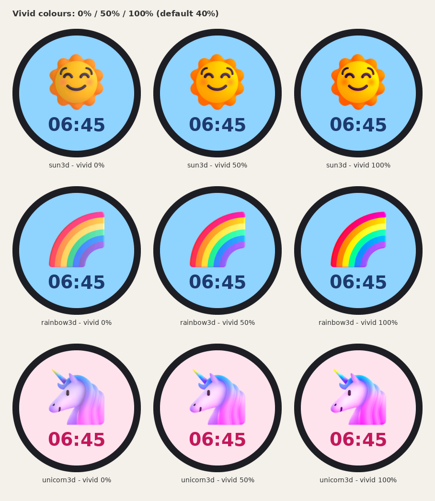

## Flashing

### Option A: in the browser, without installing anything

1. Download `kido-clock-esp32c3-merged.bin` from the [Releases](../../releases) page (or from this package's `release/` folder).
2. Open **https://espressif.github.io/esptool-js/** in **Chrome or Edge**. Web Serial is required.
3. Plug in the board with a USB-C data cable and click **Connect**. Then pick the board's serial port, usually "USB JTAG/serial debug unit".
4. Set **Flash Address** to `0x0`, choose the `.bin` file and click **Program**.
5. When it finishes, unplug the board and plug it back in, or press RST.

- If the board is not detected, hold **BOOT**, tap **RST**, release **BOOT** and click Connect again.
- Erasing the flash is optional. The merged image is written from `0x0` up to the end of the app, so it also clears the saved Wi-Fi network. The clock starts the setup portal again.
- The merged image contains the bootloader (`0x0`), partition table (`0x8000`), `boot_app0` (`0xe000`) and app (`0x10000`). The settings filesystem formats itself on first boot.

> **Updating from 1.0.x:** version 1.1 changes the partition layout (see [Partitions](#partitions)). The settings filesystem moves, so **your daily plan and other settings reset to defaults once**. Write them down first, or save the JSON from `http://kido-clock.local/api/config`. With PlatformIO upload, the saved Wi-Fi network is kept, because NVS stays at the same place. With the merged image, you set up Wi-Fi again.

`release/manifest.json` and `release/index.html` form a one-click [ESP Web Tools](https://esphome.github.io/esp-web-tools/) installer. Host them over HTTPS next to the `.bin`, for example on GitHub Pages.

### Option B: PlatformIO

Install [PlatformIO](https://platformio.org/) (the VS Code extension, or `pip install platformio`). Then run:

```bash
cd firmware
pio run -e esp32c3 -t upload      # ESP32-C3 SuperMini + round GC9A01 (default)
pio device monitor                # logs at 115200 baud
```

| Env | Hardware |
|---|---|
| `esp32c3` | ESP32-C3 SuperMini + GC9A01 (default) |
| `esp32s3` | ESP32-S3 devkit + GC9A01 |
| `esp32c3_st7789` | ESP32-C3 SuperMini + 2.0" ST7789 240x320 with PWM backlight on GPIO3 |

- The first build downloads the toolchain and takes a few minutes.
- If the upload doesn't start, use the BOOT/RST sequence above.
- To build the merged image yourself:

```bash
cd firmware/.pio/build/esp32c3
esptool --chip esp32c3 merge-bin -o kido-clock-esp32c3-merged.bin \
  0x0 bootloader.bin 0x8000 partitions.bin \
  0xe000 /path/to/boot_app0.bin 0x10000 firmware.bin
```

### Partitions

All envs use `firmware/partitions_4mb_noota.csv` (4 MB flash):

| Name | Type | Offset | Size |
|---|---|---|---|
| `nvs` | data/nvs | `0x9000` | 20 KB (Wi-Fi credentials; same place as before) |
| `app0` | app/factory | `0x10000` | 3 MB |
| `spiffs` | data/spiffs (LittleFS) | `0x310000` | 960 KB (settings) |

There is no over-the-air update. Updates are flashed over USB. Dropping OTA doubles the app space, which the colour icons need.

## First setup

1. Plug the clock into a USB-C charger. The screen asks you (in English) to set up Wi-Fi.
2. On your phone, join the Wi-Fi network **`Kido-Clock-Setup`**. The setup page should open by itself. If it doesn't, go to **http://192.168.4.1**.
3. On the first page, pick the language (English, Polski, Deutsch, Español, Français). The portal reloads in that language, and the clock's own screen switches too. The choice is saved at once, so it survives failed attempts and a reopened portal. The clock and the web UI start in that language. You can change it later in the web UI.
4. Tap **Set up Wi-Fi**, pick your home network (2.4 GHz), enter the password and tap **Save**.
5. The screen counts the seconds while the clock connects, then it fetches the time. The Wi-Fi password is stored only in the ESP32's flash.

| First page: language picker (after a failed attempt) | Wi-Fi form in Polish |
|---|---|
| 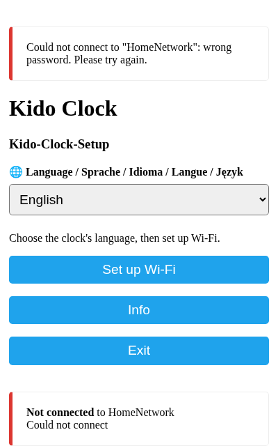 | 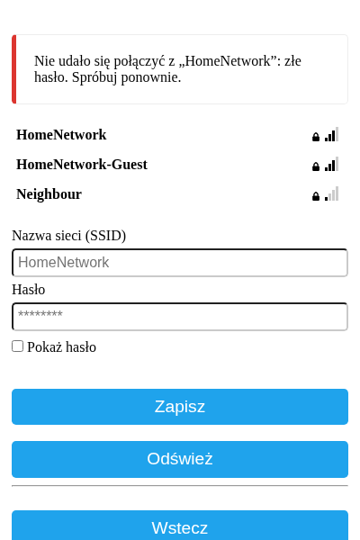 |

If the connection fails (wrong password, network not found, or no connection within about 20 s), the clock shows the reason on its screen in the chosen language and opens `Kido-Clock-Setup` again. The setup page then shows the same error at the top, so you can fix the password and try again. The screen alternates between the error and the setup instructions.

If a saved network stops working later (router changed or off), the clock tries for 25 s, shows the reason and opens the portal. If nobody configures Wi-Fi within 5 minutes, the clock keeps retrying on its own. After 10 minutes offline it restarts.

After a successful connection, if Wi-Fi drops (for example the router restarts), the firmware reconnects in the background and re-announces `kido-clock.local` when the IP returns. A small Wi-Fi badge appears on the screen while it is offline or reconnecting.

## Using the web UI

On a phone or computer on the same network, open **http://kido-clock.local**. Older Android versions don't resolve `.local` names, so use the IP address shown in your router or the serial log instead.

| Daily plan | Edit a time slot | Screensaver |
|---|---|---|
|  |  |  |

Screenshots of the settings panel are at the [top of this README](#settings-panel).

- The page is split into sections. Click a section header (or use Tab and Enter) to open or close it. **Daily plan** is open by default and the others are closed. Your browser remembers which sections you opened.
- **Daily plan**: a list of time slots. Each slot lasts from its start time until the next slot starts, including across midnight.
- **Add / Edit** a slot to set the start time and days, the icon, the colours, an optional label, and the brightness. **Show** displays the slot on the clock for 15 s.
- **Display**: max brightness, show clock / show label, **clock style** (digital or analog), panel colour profile and vivid colours.
- **Screensaver**: mode **off / eyes / clock**, idle time, and (when eyes are selected) eye colour, background, shape, speed, night behaviour, and time under the eyes. **Show eyes now** previews for 20 s.
- **Language**: changes the web UI and the clock's own messages. Slot labels are your own text and are not translated.
- **Save**: writes the settings to the clock (red action button).
- **Wi-Fi and device** → **Change Wi-Fi network**: the clock forgets the network and starts `Kido-Clock-Setup` again.

Default plan:

| From | Days | Icon | Brightness |
|---|---|---|---|
| 06:45 | Mon-Fri | `sun3d` "Time to get up!" | 100% |
| 07:30 | Sat-Sun | `sun3d` | 100% |
| 18:30 | every day | `openbook3d` "Story time" | 70% |
| 19:30 | every day | `bed3d` "Bedtime" | 45% |
| 20:15 | every day | `moon3d` "Still sleeping" | 20% |

The default labels are in the language chosen during setup.

At weekends the moon stays until 07:30, because the 06:45 slot runs on weekdays only.

### HTTP API

| Method | Path | Description |
|---|---|---|
| `GET` | `/api/config` | full configuration (JSON) |
| `POST` | `/api/config` | save the full configuration (same format, validated) |
| `GET` | `/api/status` | time, date, weekday, active slot, NTP sync, language, IP, RSSI, light sensor, free heap (`heap`, `heapMaxBlock`), firmware `version`, uptime, `eyes` (true while the eyes are shown), `panelProfiles` (false on the ST7789 build) |
| `POST` | `/api/preview` | show a slot for 15 s |
| `POST` | `/api/eyes-preview` | show the eyes for 20 s. An optional body with `eyes` settings (same format as in the config) previews them without saving |
| `POST` | `/api/display` | try `panel` and/or `vivid` at once, without saving (`{"panel":"extra","vivid":60}`) |
| `POST` | `/api/wifi-reset` | forget Wi-Fi and restart |
| `GET` | `/icons/<id>.qoi` | an icon (QOI image, 156 px), used by the web UI previews |

```json
{"lang":"en","maxBright":100,"autoDim":false,"showClock":true,"showLabel":false,
 "clockStyle":"digital","saver":"eyes",
 "panel":"vivid","vivid":40,
 "eyes":{"on":true,"color":"#4FD1FF","bg":"#000000","shape":"round","speed":100,
         "idle":2,"night":"off","clock":true},
 "slots":[{"start":"20:15","days":127,"icon":"moon3d",
           "bg":"#0B1030","tx":"#FFE08A","bright":20,"label":"Still sleeping"}]}
```

`days` is a bitmask: Mon=1, Tue=2, Wed=4, Thu=8, Fri=16, Sat=32, Sun=64. For example, 127 is every day, 31 is Mon-Fri and 96 is the weekend.

`clockStyle` is `digital` or `analog`. `saver` is `off`, `eyes` or `clock`. `panel` (`standard`, `vivid` or `extra`), `vivid` (0-100) and `eyes` are optional when you post a configuration (defaults as above). `shape` is `round` or `rect`, `speed` is 50-200 (%), `idle` is 1-60 minutes, `night` is `off` or `sleepy`. Older configs without `clockStyle` / `saver` keep digital time and derive the saver from `eyes.on`.

## Eyes screensaver

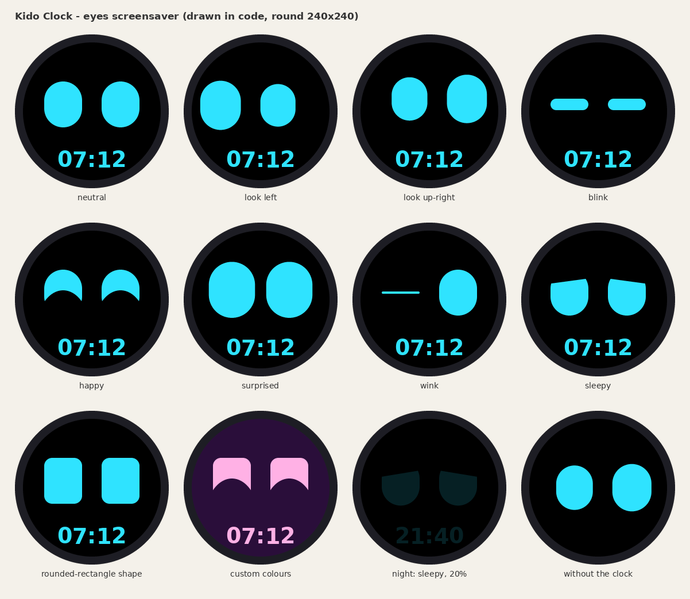

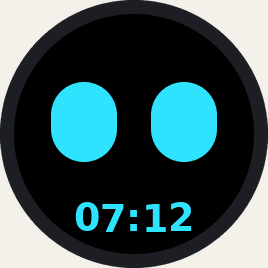

After `idle` minutes without a button press (2 by default) the clock shows two friendly eyes instead of the icon (when saver mode is **eyes**). They are drawn in code, with no images: they look around with smooth easing, blink at random (sometimes twice), and now and then squint happily, open wide in surprise, wink or get sleepy with drooping lids. A button press brings the clock back. The press only wakes the clock; the next press lights up the screen as usual.

- **Colours and shape**: any eye and background colour, round (pill) or rounded-rectangle eyes.
- **Speed**: 50-200 %, scales all the movements.
- **Time under the eyes**: on by default; the eyes move up a little to make room.
- **Brightness**: the eyes use the active slot's brightness (and the light sensor, if any), like the icons.
- **At night**: the sleep icons (`moon3d`, `sleeping3d`, `star3d`, `bed3d`) mark night slots. By default the eyes stay off there and the night icon remains. With **Sleepy, dimmed eyes** the screensaver also runs at night, with half-closed lids, slow movements and the slot's dim brightness.
- **Show eyes now** in the web UI shows the eyes for 20 s with the current (even unsaved) settings, at the maximum brightness setting.

With saver mode **clock**, the idle screen is a large digital or analog clock in the active slot's colours instead of the eyes.

The eyes render at about 30 fps without a full-screen buffer: each frame rasterizes only the rows the eyes cover (now or in the previous frame), with anti-aliased edges, and streams them to the display 8 rows at a time. That needs 3.7 KB of static RAM (an 8 x 232 pixel line buffer plus a 232-byte coverage row) and no heap. `firmware/tools/eyes.py` is a line-by-line Python port of `firmware/src/eyes.cpp` (the same random sequence and pixel output), used by `firmware/tools/render_eyes.py` to draw `docs/eyes.png` and `docs/eyes.gif`.

## Languages

| Code | Language |
|---|---|
| `en` | English (default) |
| `pl` | Polski |
| `de` | Deutsch |
| `es` | Español |
| `fr` | Français |

Each language is one file, `firmware/lang/<code>.json`, with three sections:
- `device`: messages on the clock's screen and the default slot labels.
- `web`: all web UI strings.
- `portal`: the Wi-Fi setup portal. The portal pages come from WiFiManager in English; a small script in each page replaces its texts with these strings (the mapping is `PORTAL_WM` in `firmware/tools/i18n_def.py`).

Missing keys fall back to English. The on-screen font (DejaVu Sans Bold, anti-aliased VLW) holds only the glyphs the shipped languages need. These come from each file's `alphabet` plus every character used in its `device` strings.

### Adding a language

1. Copy `firmware/lang/en.json` to `firmware/lang/<code>.json`, using a 2-letter ISO 639-1 code such as `it`.
2. Set `"name"` to the language's own name, e.g. `"Italiano"`.
3. Set `"alphabet"` to every non-ASCII letter of the language, upper and lower case, e.g. `"àèéìíòóùúÀÈÉÌÍÒÓÙÚ"`. These glyphs are added to the on-screen font so users can type labels with them.
4. Translate the `device`, `web` and `portal` values. Keep the keys, keep `days_short` as 7 items starting on Monday, and keep labels short, because they must fit on a round 240 px screen.
5. Build: `cd firmware && pio run -e esp32c3`. `tools/gen_assets.py` runs automatically before each build. It picks up the new file, regenerates `src/i18n_gen.h`, the web page and the fonts, and the language appears in the web UI's **Language** menu.
   - Regenerating fonts needs Pillow (`pip install pillow`). Without Pillow the committed `src/fonts_gen.h` is reused, and new letters won't render.
6. Optional: check the web UI in your language at `firmware/tools/out/index_preview.html?lang=<code>`, a standalone demo for any browser.

The language picked in the Wi-Fi setup portal is saved and used from the first start. `DEFAULT_LANG` in `firmware/tools/i18n_def.py` (`en`) sets the language used before that choice and when no choice is made. The on-device setup and error screens before the portal use the saved language, which is English on a fresh clock.

**Flash cost.** Each language adds about 5 KB of strings (screen, web UI and setup portal). Each new glyph adds about 0.25 KB to the 20 px label font. Measured on this build:

| Added language | New glyphs | Approx. flash cost |
|---|---|---|
| Italian / Portuguese | 4 | ~4 KB |
| Czech | 20 | ~8.5 KB |
| Ukrainian (Cyrillic) | 67 | ~19 KB |

The ESP32-C3 app image (v1.3.2) is about 2.90 MB (2,903,784 bytes) of its 3 MB slot (3,145,728 bytes), which leaves about 242 KB free (~92.3% used). The 58 icons take about 1.12 MB of that (about 20 KB each). The web UI is stored gzip-compressed.

## Icons

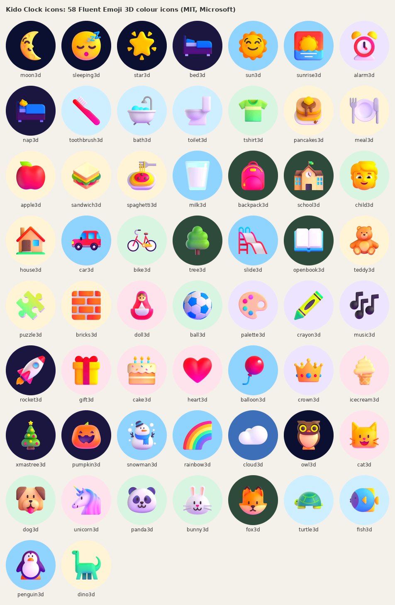

All 58 icons are Fluent Emoji 3D images by Microsoft, under the MIT license (see [THIRD_PARTY_NOTICES.md](THIRD_PARTY_NOTICES.md)), defined in `firmware/tools/icons_def.py`. They are trimmed to their visible pixels, scaled so the longer side is 140 px (90% of the box) and centred, so every icon has the same visual size and sits in the middle. They are stored once at 156 px in `firmware/assets/icons3d/*.qoi` (QOI, colours rounded to RGB565, 8-bit alpha) and compiled into the firmware. The clock decodes them on the fly, scales them to the layout size (156 px alone, 130 px with the clock or the label, 110 px with both), blends the edges with the slot background and applies the brightness. No extra RAM buffer or sprite is used. Each slot can change the background and the text colour; the icons keep their own colours.

Version 1.1.1 removed the 6 classic vector icons (`moon`, `sun`, `bed`, `star`, `book`, `heart`). A saved or uploaded configuration that still uses them is mapped to `moon3d`, `sun3d`, `bed3d`, `star3d`, `openbook3d` and `heart3d`.

The generator turns the definitions into C code for the device, JavaScript for the web previews and PNG mockups (`python3 firmware/tools/render_mockups.py`), so the web UI and the screen always match. See [CONTRIBUTING.md](CONTRIBUTING.md) for adding icons.

Colour icon ids: `moon3d sleeping3d star3d bed3d sun3d sunrise3d alarm3d toothbrush3d bath3d toilet3d tshirt3d pancakes3d meal3d apple3d backpack3d school3d house3d car3d tree3d openbook3d teddy3d puzzle3d ball3d palette3d music3d rocket3d gift3d cake3d heart3d rainbow3d cloud3d owl3d cat3d dog3d unicorn3d`, and since 1.2.0 `nap3d sandwich3d spaghetti3d milk3d child3d bike3d slide3d bricks3d doll3d crayon3d balloon3d crown3d icecream3d xmastree3d pumpkin3d snowman3d panda3d bunny3d fox3d turtle3d fish3d penguin3d dino3d`.

## Troubleshooting

| Problem | Fix |
|---|---|
| Colours look inverted, like a negative | In `firmware/src/lgfx_setup.h` change `cfg.invert = true` to `false`. |
| Red and blue are swapped | In `firmware/src/lgfx_setup.h` set `cfg.rgb_order = true`. |
| Screen stays black | Check VCC→3V3, GND, SCL→GPIO4 and SDA→GPIO6. Try connecting RST. |
| Board not detected when flashing | Use a data (not charge-only) USB cable. Hold BOOT, tap RST, release BOOT. |
| "Wrong password", "Network not found" or "No connection" on the clock (ESP32-C3 SuperMini) | Many SuperMini boards have a weak antenna and fail to connect at full TX power. The `esp32c3` envs cap it at 8.5 dBm with `-D KIDO_WIFI_TX_POWER=WIFI_POWER_8_5dBm` in `firmware/platformio.ini`. If it still fails, try `WIFI_POWER_5dBm`, or `WIFI_POWER_11dBm` if the router is far away. Use a **2.4 GHz** network (the ESP32 can't see 5 GHz) and check the password. After a failed attempt the screen shows the reason and the `Kido-Clock-Setup` portal opens again, with the error at the top of the page. The serial log at 115200 baud prints the Wi-Fi status and the disconnect reason: 201 means the network wasn't found, and 15 or 204 usually means a wrong password. |
| `kido-clock.local` doesn't open | Use the IP address. Guest networks with client isolation block local access. After a reconnect, wait a few seconds for mDNS to re-announce. |
| Clock loses Wi-Fi after the router restarts | Fixed in 1.3.x: the firmware reconnects in the loop and restarts mDNS on `GOT_IP`. Update if you are on an older build. |
| Wrong time | The clock needs internet at start-up (there is no RTC battery). The time zone is Central European (`CET-1CEST`). Change `TZ_INFO` in `firmware/src/main.cpp` for other zones. |
| Colours look pale or washed out | Open **Colours** in the web UI: try the **Extra vivid** panel profile and raise **Vivid colours**. See [Colours](#colours). |
| Faint glow at night | Expected with this display. See [Brightness without a backlight pin](#brightness-without-a-backlight-pin). |

## Enclosure

**This repository ships no STL files or PCB layouts on purpose.** The MSK-01 housing in the photos is just one example: everyone is free to design a case and boards that fit their own build.

The current device is a **test version, assembled by hand** on perfboard with point-to-point wiring (see [Wiring](#wiring)). Custom PCBs and an expanded robot with new features are planned for future versions.

If you print your own housing, leave a round window for the 1.28" screen, a USB-C opening at the back and a hole for the button. Matte white filament suits the MSK-01 look (white shell, red button, black screen bezel).

## How my build was made

These photos show how I assembled the hand-built test version. Treat them as an example, not as a required layout.

| Breadboard prototype | Front: screen and button on perfboard |
|---|---|
| 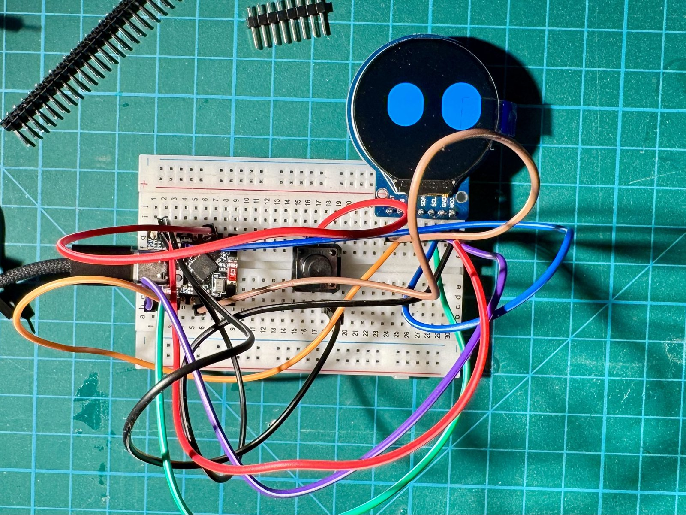 | 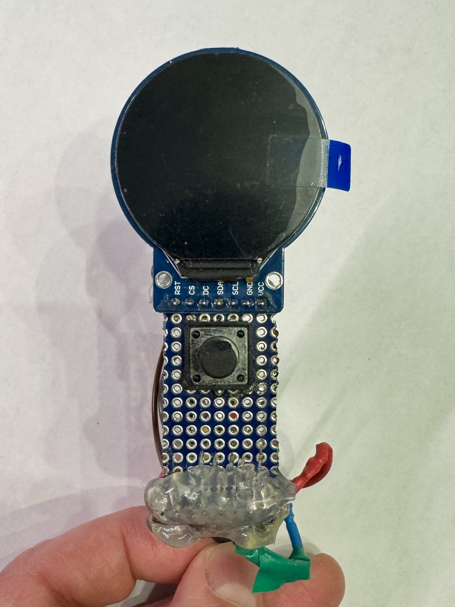 |

| Back: ESP32-C3 SuperMini wiring | Side view |
|---|---|
| 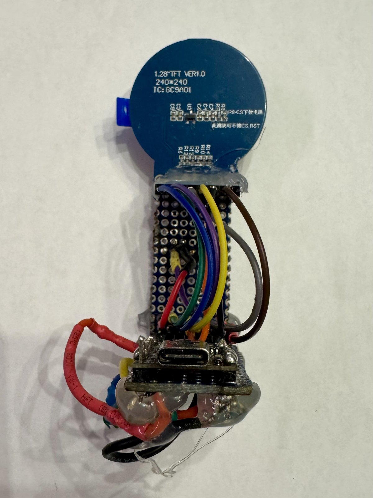 | 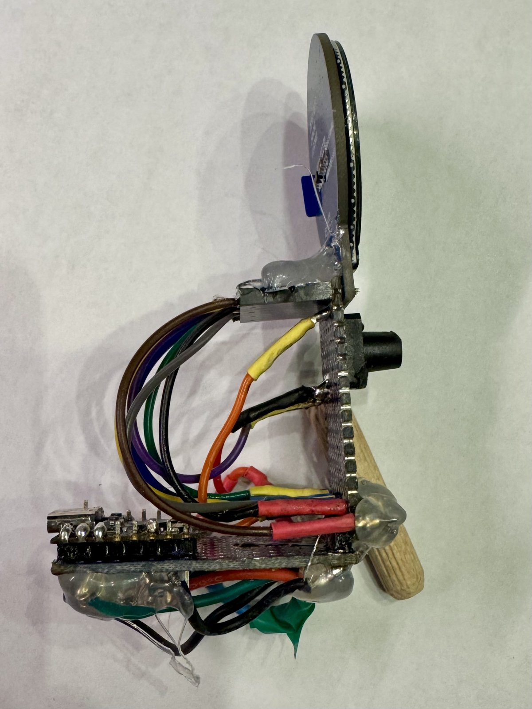 |

| Printing the enclosure | Finished MSK-01 |
|---|---|
| 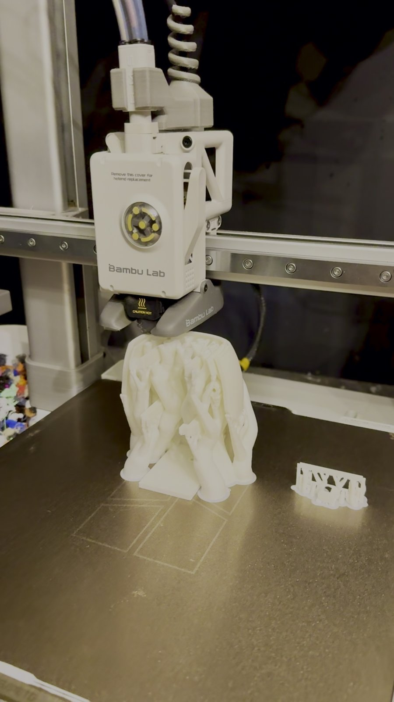 |  |

## Repository layout

```
kido-clock/
├── firmware/            PlatformIO project (Arduino, LovyanGFX, ArduinoJson, WiFiManager)
│   ├── platformio.ini
│   ├── partitions_4mb_noota.csv
│   ├── src/             main.cpp, config.*, screen.*, eyes.*, board_pins.h, lgfx_setup.h, version.h,
│   │                    *_gen.h and icons_img_gen.cpp (generated)
│   ├── assets/icons3d/  colour icons (QOI), produced by tools/fetch_icons.py
│   ├── web/index.html   web UI template (embedded into the firmware)
│   ├── lang/            one JSON file per language
│   └── tools/           gen_assets.py, icons_def.py, i18n_def.py, bitmap_icons.py, fetch_icons.py,
│                        vlw.py, render_mockups.py, render_portal_mock.py, eyes.py,
│                        render_eyes.py, fonts/
├── bom/                 bill of materials (xlsx + csv)
├── docs/                images used in this README
│   └── images/          enclosure photos, settings-panel screenshots, wiring.svg
├── release/             web installer (manifest.json, index.html) + merged .bin
└── tools/               scripts for the BOM and the wiring diagram
```

Host-side scripts need Python 3 with `pillow` (fonts, mockups, `fetch_icons.py`), `matplotlib` (wiring diagram) and `openpyxl` (BOM).

## Credits

Kido Clock is created and maintained by **Mateusz Misztoft**.

Questions, ideas or your own build? Reach me on X: [@mat_misztoft](https://x.com/mat_misztoft).

## License

[MIT](LICENSE). Copyright (c) 2026 Mateusz Misztoft.

The colour icons are Fluent Emoji by Microsoft (MIT). The bundled DejaVu Sans font is under its own free license. Details and full license texts: [THIRD_PARTY_NOTICES.md](THIRD_PARTY_NOTICES.md).
